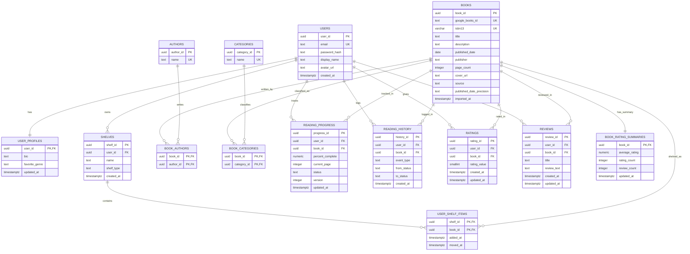

# ER Diagram — Book Metaverse Portal

This document describes **[`ER_diagram.png`](ER_diagram.png)** in this folder. It is a
companion reference for reading the diagram, not a replacement for the schema:
the versioned migrations in [`database/migrations/`](database/migrations/) are the
source of truth.

> **Note:** `ER_diagram.png` replaces the earlier `finalized_er_diagram.png`
> (2026-10-08, kept outside this repository and since removed). That revision
> lacked the `BOOKS` columns added by migration `000006` and drew a redundant
> `BOOK_CATEGORIES` box. Only `ER_diagram.png` is current.

## 1. What the diagram shows

The diagram is a **Chen-style entity–relationship model** of the catalog, user,
and reading-activity data. It uses:

| Symbol | Meaning |
| --- | --- |
| Rectangle (lavender) | **Entity** (a table) |
| Diamond (white) | **Relationship** between entities |
| Small rectangle attached by a dotted line | **Attribute carried by the relationship** (a column on the junction/association table) |
| Line ending in `1..1`, `0..*`, `1..*` | **Cardinality** of that relationship end |
| `[PK]`, `[FK]` | Primary key / foreign key |
| `U` / `US` prefix | Unique column (`US email`, `US name`, `US google_books_id`, `US isbn13`) |

Seven entities are drawn as boxes:

```
USERS, USER_PROFILES, AUTHORS, CATEGORIES, SHELVES, BOOKS, BOOK_RATING_SUMMARIES
```

Seven junction/activity tables are represented as **relationships** (diamonds)
with attribute boxes instead of standalone entity boxes:

```
book_authors, book_categories, user_shelf_items, reading_progress,
reading_history, ratings, reviews
```

That style is valid Chen notation for an association, but when you implement or
query the model each diamond is a real table with a composite key.

## 2. Layout at a glance

```text
                              USERS
                                │
        ┌───────────┬───────────┼───────────┬───────────┐
        │           │           │           │           │
      has         owns      progress     history    ratings / reviews
        │           │           │           │           │
 USER_PROFILES   SHELVES        └───────────┴──────► BOOKS ◄── book author ── AUTHORS
                    │                                  │
              User Shelf Items                         └── book category ── CATEGORIES
                    │                                  │
                    └──────────────► BOOKS ◄───────────┴── has summary ── BOOK_RATING_SUMMARIES
```

- **Top:** `USERS`, the hub every user-scoped relationship starts from.
- **Left:** reference entities — `USER_PROFILES`, `AUTHORS`, `CATEGORIES`.
- **Center:** `SHELVES` and the `User Shelf Items` association.
- **Bottom:** `BOOKS`, with the catalog and activity diamonds fanning up into it.
- **Lower right:** `BOOK_RATING_SUMMARIES`, the derived per-book aggregate.

## 3. Entities and attributes

The attribute lists below are exactly what is drawn.

### USERS

| Attribute | Marker |
| --- | --- |
| `user_id` | `[PK]` |
| `email` | `US` (unique) |
| `password_hash` | — |
| `display_name` | — |
| `avatar_url` | — |
| `created_at` | — |

### USER_PROFILES

| Attribute | Marker |
| --- | --- |
| `user_id` | `[PK, FK]` → `users.user_id` (one-to-one) |
| `bio` | — |
| `favorite_genre` | — |
| `updated_at` | — |

### AUTHORS

| Attribute | Marker |
| --- | --- |
| `author_id` | `[PK]` |
| `name` | `US` (unique, ignoring case and surrounding spaces) |

An author is identified by name. Two different people who share a name are
stored as one author, because Google Books returns names without author IDs and
the import relies on the unique name to avoid duplicate rows. See
[Known limitation: authors are identified by name](#8-known-limitation-authors-are-identified-by-name).

### CATEGORIES

| Attribute | Marker |
| --- | --- |
| `category_id` | `[PK]` |
| `name` | `US` (unique) |

### SHELVES

| Attribute | Marker |
| --- | --- |
| `shelf_id` | `[PK]` |
| `user_id` | `[FK]` → `users.user_id` |
| `name` | — |
| `shelf_type` | — (`want_to_read`, `currently_reading`, `finished`, `paused`, `custom`) |
| `created_at` | — |

### BOOKS

| Attribute | Marker |
| --- | --- |
| `book_id` | `[PK]` |
| `google_books_id` | `US` (unique, nullable) |
| `isbn13` | `US` (unique, nullable, 13 digits) |
| `title` | — |
| `description` | — |
| `published_date` | — |
| `publisher` | — |
| `page_count` | — |
| `cover_url` | — |
| `source` | — (`seed`, `google`, `user`; added by migration `000006`) |
| `published_date_precision` | — (`year`, `month`, `day`; added by `000006`) |
| `imported_at` | — (set for Google-imported rows; added by `000006`) |

The full-text column `books.search_vector` (migration `000002`) is intentionally
not drawn.

### BOOK_RATING_SUMMARIES

| Attribute | Marker |
| --- | --- |
| `book_id` | `[PK, FK]` → `books.book_id` (one-to-one) |
| `average_rating` | — |
| `rating_count` | — |
| `review_count` | — |
| `updated_at` | — |

This is a derived/cache table maintained by the rating and review triggers, not
by application code. The row is created automatically when a book is inserted.

## 4. Relationships

| Diamond | Entity A | Entity B | Cardinality as intended | Attributes on the diamond | Physical table |
| --- | --- | --- | --- | --- | --- |
| `has` | `USERS` | `USER_PROFILES` | 1 : 1 | — | `user_profiles` (shared PK) |
| `owns` | `USERS` | `SHELVES` | 1 : 0..* | — | `shelves.user_id` |
| `User Shelf Items` | `SHELVES` | `BOOKS` | 1 : 0..* entries per shelf; each entry → 1 book | `added_at`, `moved_at` | `user_shelf_items` (M:N) |
| `book author` | `AUTHORS` | `BOOKS` | M:N, `0..*` on both sides: a book may have no authors (some Google volumes list none) and an author may have no books | `book_id`, `author_id` | `book_authors` (composite PK) |
| `book category` | `CATEGORIES` | `BOOKS` | M:N, `0..*` on both sides | `book_id`, `category_id` | `book_categories` (composite PK) |
| `reading progress` | `USERS` | `BOOKS` | one row per user–book pair | `percent_complete`, `current_page`, `status`, `version`, `updated_at` | `reading_progress` (unique `user_id, book_id`) |
| `reading history` | `USERS` | `BOOKS` | append-only event log | `history_id`, `event_type`, `from_status`, `to_status` | `reading_history` |
| `ratings` | `USERS` | `BOOKS` | one rating per user–book pair | `rating_id`, `rating_value`, `created_at`, `updated_at` | `ratings` (unique `user_id, book_id`) |
| `reviews` | `USERS` | `BOOKS` | one review per user–book pair | `review_id`, `title`, `review_text`, `created_at`, `updated_at` | `reviews` (unique `user_id, book_id`) |
| `has summary` | `BOOKS` | `BOOK_RATING_SUMMARIES` | 1 : 1 | — | `book_rating_summaries` (shared PK) |

Cardinality labels (`1..1`, `0..*`) appear at both ends of each line in the
diagram. They are not applied the same way on every line: for the four
user-activity diamonds (`reading progress`, `reading history`, `ratings`,
`reviews`) the picture shows `0..*` at `USERS` and `1..1` at `BOOKS`, while the
real rule is many-to-many between users and books, limited to one row per
user–book pair for progress, ratings, and reviews. The table above states what
the schema enforces; use it, not the labels, when they differ.

### Reading a path

- **A user's profile:** `USERS` —`has`→ `USER_PROFILES`.
- **A user's shelves and their books:** `USERS` —`owns`→ `SHELVES` —`User Shelf Items`→ `BOOKS`.
- **A user's activity on a book:** `USERS` —`reading progress` / `reading history` / `ratings` / `reviews`→ `BOOKS`.
- **A book's catalog detail:** `BOOKS` —`book author`→ `AUTHORS`, `BOOKS` —`book category`→ `CATEGORIES`.
- **A book's aggregate score:** `BOOKS` —`has summary`→ `BOOK_RATING_SUMMARIES`.

These are the join paths behind the shelf listing, dashboard, book detail, and
report queries under [`database/queries/`](database/queries/).

## 5. What the diagram intentionally omits

- **Keys on diamonds.** `reading_progress.progress_id` and the foreign keys
  `user_id` / `book_id` on the activity tables are implied by the relationship
  lines. `history_id`, `rating_id`, and `review_id` are drawn.
- **One timestamp on a diamond.** `reading_history.created_at` is not drawn; it
  exists in the schema. `ratings` and `reviews` show both timestamps.
- **Indexes, constraints, and triggers.** These live in the migrations.
  `books.search_vector` is deliberately omitted.
- **Junction tables as boxes.** `book_authors`, `book_categories`, and
  `user_shelf_items` appear only as diamonds plus attribute boxes.

For the authoritative column list, see
[`database/schema/schema.sql`](database/schema/schema.sql); for behavior, see
the versioned migrations.

## 6. Equivalent Mermaid model

The Mermaid rendering below is the **relational equivalent** of the picture: it
promotes each relationship diamond to the table that implements it, which is how
`sqlc` and the Go repositories see the data.



## 7. Consistency check against the migrations

The diagram matches migrations `000001`–`000006`:

- Every entity box has the columns the schema defines for that table, except
  `books.search_vector` (section 3). The diamonds carry the extra columns of
  their tables, except `reading_history.created_at` and the keys listed in
  section 5.
- `BOOKS` includes `source`, `published_date_precision`, and `imported_at`
  (`000006`).
- One-to-one tables share the parent primary key (`user_profiles.user_id`,
  `book_rating_summaries.book_id`).
- Junction tables are composite-keyed (`book_authors`, `book_categories`,
  `user_shelf_items`).
- The user–book activity tables enforce one row per pair where appropriate
  (`reading_progress`, `ratings`, `reviews`); `reading_history` is append-only.

Not shown, but implemented: `search_vector` and its GIN index (`000002`), the
case-insensitive form of the author and category name uniqueness and the
one-shelf-per-status-type partial index (`000003`), reporting indexes
(`000004`), the append-only history trigger (`000005`), and the Google-source
CHECK constraints (`000006`).

## 8. Known limitation: authors are identified by name

`authors.name` is unique ignoring case and surrounding spaces (index
`authors_name_ci_unique_idx`, migration `000003`). Two different people with the
same name therefore share one `authors` row, and their books are linked to it.

This is a deliberate trade-off for the MVP:

- Google Books returns author names only, with no author IDs, so an import
  cannot tell same-named people apart.
- `UpsertAuthor` uses the unique name as its conflict target. Without it, every
  imported book would add another row for the same author, which would break the
  authors page and the author rankings.

Allowing duplicates would need a new migration, a different upsert, and extra
data to tell authors apart (for example a birth year or an external ID).
