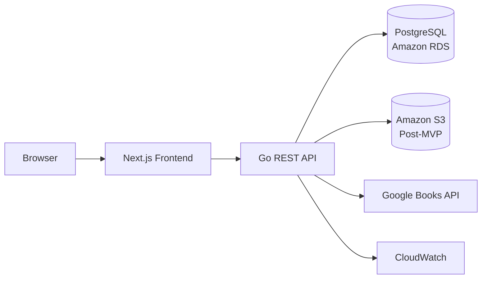

# Book Metaverse Portal

**Course:** CMPE-180B
**Project type:** Database Systems Project

Book Metaverse Portal is a database-driven platform for discovering, organizing,
and tracking books. Users will be able to maintain a reading profile, search the
book catalog, organize books into shelves, track reading progress and history,
and submit ratings and reviews.

The relational database is the source of truth for the application. The project
uses explicit SQL so that schema design, joins, transactions, functions,
triggers, indexes, and query plans remain visible and demonstrable.

S3 is beyond the database MVP. The MVP stores catalog metadata and image URLs in
PostgreSQL and may use Google Books cover URLs. S3-backed cover, avatar, or file
uploads are a post-MVP extension.

## Architecture

The system follows a three-tier architecture:



- **Presentation tier:** The Next.js frontend renders the interface and calls
  the backend over HTTP/REST.
- **Application tier:** The Go API validates requests, applies business rules,
  manages transaction boundaries, and executes explicit SQL.
- **Data tier:** PostgreSQL stores users, catalog data, shelves, reading
  activity, ratings, reviews, and derived summaries.

The frontend never connects directly to PostgreSQL and never receives database
credentials. All database access passes through validated API endpoints.

The deployed database uses PostgreSQL 18 on Amazon RDS, and the Terraform
scaffold defaults to the same engine and version.

## Technology Stack

| Layer | Technology | Role |
| --- | --- | --- |
| Frontend | Next.js, React, TypeScript | Application interface and server-side rendering |
| Styling | Tailwind CSS | Responsive UI |
| Frontend data | TanStack Query | API caching, loading states, and synchronization |
| Forms | React Hook Form and Zod | Form state and validation |
| Backend | Go | REST API and database operations |
| HTTP routing | Chi or Gin | Routing, middleware, and request handling |
| PostgreSQL access | `pgx` | Connection pooling and database access |
| SQL generation | `sqlc` | Type-safe Go code generated from explicit SQL |
| Migrations | `golang-migrate` or Goose | Versioned schema changes |
| Authentication | JWT and Argon2id | Access control and password hashing |
| Database | PostgreSQL 18 | Primary relational data store |
| Cloud database | Amazon RDS for PostgreSQL 18 | Managed production database |
| Search | PostgreSQL `tsvector`, `pg_trgm`, and GIN indexes | Full-text and fuzzy search |
| Optional search | `pgvector` | Semantic similarity search, if added later |
| Object storage | Amazon S3 (post-MVP) | Self-hosted covers and future uploads |
| Local development | Docker Compose | Reproducible application and database environment |
| Production containers | Amazon ECR and ECS Fargate | Image registry and API deployment |
| Monitoring | Amazon CloudWatch | Logs, metrics, and alerts |
| Testing | Go tests, Testcontainers, and Playwright | Backend, database, and browser tests |

## Repository Layout

```text
Team_Project/
├── frontend/   # Next.js presentation tier
├── backend/    # Go application and API tier
├── infra/      # Terraform for the AWS data tier
├── docs/       # Architecture, database, API, and project documentation
└── README.md
```

As implementation proceeds, database artifacts should be organized under a
shared `database/` directory for migrations, generated queries, seeds,
functions, triggers, performance tests, and validation cases.

See the [Terraform infrastructure notes](infra/README.md) and
[project documentation](docs/README.md) for area-specific details.

## Data Model

The core relational entities are:

- `users` and `user_profiles`
- `books`, `authors`, and `categories`
- `book_authors` and `book_categories`
- `shelves` and `user_shelf_items`
- `reading_progress` and `reading_history`
- `ratings` and `reviews`
- `book_rating_summaries`

Important relationships include:

- Each user has one profile and owns multiple shelves.
- Shelves contain books through the `user_shelf_items` junction table.
- Books have many-to-many relationships with authors and categories.
- Users can track progress, ratings, and reviews for many books.
- Each book has one rating-summary record.

## Database Requirements

The implementation must demonstrate:

- Primary keys, foreign keys, composite keys, unique constraints, and check
  constraints.
- Transactions for shelf changes, reading progress, reviews, and ratings.
- Functions and triggers for protected or derived data.
- Complex joins, CTEs, aggregations, and window functions.
- Multi-session concurrency tests and reproducible rollback scenarios.
- B-tree, composite, partial, and GIN indexes.
- Query plans captured with `EXPLAIN (ANALYZE, BUFFERS)`.
- Reproducible validation cases with documented expected results.

The API must use explicit SQL rather than hiding database behavior behind a
high-level ORM. Google Books is used only for catalog import or refresh, not for
normal application queries.

## Application Layers

The backend is organized into four layers:

```text
HTTP handlers -> Services -> Repositories -> PostgreSQL
```

- **Handlers** parse requests, validate input, and return HTTP responses.
- **Services** enforce business rules and transaction boundaries.
- **Repositories** execute SQL and map rows into Go structures.
- **Database infrastructure** manages connection pools, migrations, and query
  configuration.

Middleware handles authentication, authorization, logging, request IDs, and
rate limiting. The frontend and backend should share an OpenAPI contract.

## Local Development

The Docker Compose environment currently provides the database tier:

| Service | Responsibility |
| --- | --- |
| `postgres` | Local PostgreSQL database with a named volume |
| `migrate` | Applies versioned schema migrations (`tools` profile) |
| `seed` | Loads reproducible demonstration data (`tools` profile) |

Containers should use health checks, multi-stage images, non-root users where
practical, and environment variables documented in `.env.example`. Database
credentials and other secrets must not be committed to the repository.

Create the local environment file and start PostgreSQL:

```powershell
Copy-Item .env.example .env
docker compose up -d postgres
docker compose ps
```

Once migration or seed files exist, run the one-shot services with:

```powershell
docker compose --profile tools run --rm migrate
docker compose --profile tools run --rm seed
```

The `api` and `web` services will be added to Compose after their application
scaffolds and Dockerfiles are implemented. They are not included as empty or
non-buildable placeholders.

Redis may be added later for caching, sessions, rate limiting, or real-time
features, but it is not required for the database MVP.

## AWS Deployment

The target production architecture is:

```text
Internet
   |
Route 53
   |
CloudFront
   |
Next.js on ECS Fargate or Vercel
   |
Application Load Balancer
   |
Go API on ECS Fargate
   |
Private VPC subnet
   |
Amazon RDS for PostgreSQL
```

After the MVP, Amazon S3 can store self-hosted book covers, avatars, and
uploaded assets. AWS Secrets Manager supplies database credentials and API keys
at runtime. CloudWatch collects application logs and metrics.

The RDS database must not be publicly accessible. Only the Go API security
group should be permitted to connect to it, and database credentials must never
be exposed to the frontend.

## Implementation Roadmap

1. Create the Docker Compose development environment.
2. Add PostgreSQL migrations and reproducible seed data.
3. Implement Go authentication and database connectivity.
4. Add catalog, author, category, and search features.
5. Add shelves, progress, and history with transactions.
6. Add ratings, reviews, triggers, and rating-summary maintenance.
7. Add reports, indexes, and before-and-after performance comparisons.
8. Build the Next.js interface against the API contract.
9. Add concurrency, constraint, transaction, and end-to-end tests.
10. Deploy the containers and PostgreSQL database to AWS.

After the database MVP is complete, add optional S3-backed asset uploads and
storage.

## Current Status

- [x] Three-tier architecture and technology stack documented.
- [x] Initial `frontend/`, `backend/`, `infra/`, and `docs/` directories created.
- [x] Terraform scaffold for the RDS data tier and secret storage started.
- [x] Terraform database settings aligned with PostgreSQL 18.
- [x] PostgreSQL Docker Compose environment and `.env.example`.
- [ ] API and web services added to Compose after their Dockerfiles exist.
- [ ] Database schema, migrations, and seed data.
- [ ] Go API and authentication.
- [ ] Next.js application.
- [ ] Validation, concurrency, and performance evidence.
- [ ] AWS deployment.
- [ ] S3-backed asset storage (post-MVP).

## Reference Documents

- [Technology Stack and Architecture](../../Book-Metaverse-Portal-Technology-Stack-and-Architecture.md)
- [Project Proposal](../../Book-Metaverse-Portal-Project-Proposal.md)
- [Milestone Plan](../../Book-Metaverse-Portal-Milestone-Plan.md)
