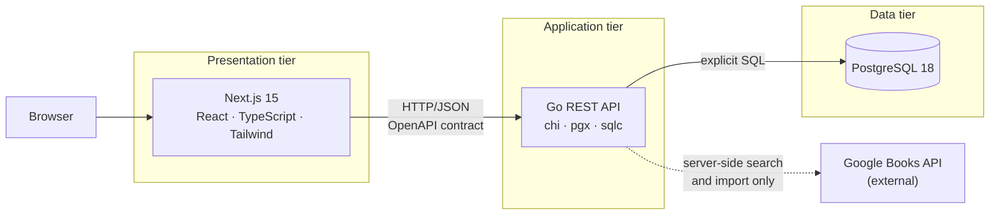

# Book Metaverse Portal

**Course:** CMPE-180B
**Project type:** Database Systems Project

Book Metaverse Portal is a database-driven platform for discovering, organizing,
and tracking books. Users will be able to maintain a reading profile, search the
book catalog, organize books into shelves, track reading progress and history,
and submit ratings and reviews.

The relational database is the source of truth for the application. The project
uses explicit SQL so that schema design, joins, transactions, functions,
triggers, indexes, and query plans remain visible and demonstrable.

S3 is beyond the database MVP. The MVP stores catalog metadata and image URLs in
PostgreSQL; imported Google books use Google Books cover URLs. S3-backed cover,
avatar, or file uploads are a post-MVP extension.

## Architecture

The system follows a three-tier architecture:



- **Presentation tier:** The Next.js frontend renders the interface and calls
  the backend over HTTP/REST.
- **Application tier:** The Go API validates requests, applies business rules,
  manages transaction boundaries, and executes explicit SQL. It also calls
  Google Books on the server for discovery and import.
- **Data tier:** PostgreSQL stores users, catalog data, shelves, reading
  activity, ratings, reviews, and derived summaries.

The browser never connects directly to PostgreSQL or Google and never receives
database credentials or the Google API key. Every data operation goes through a
validated API endpoint, and PostgreSQL remains the source of truth.

The deployed database uses PostgreSQL 18 on Amazon RDS, and the Terraform
scaffold defaults to the same engine and version.

## Technology Stack

| Layer | Technology | Role |
| --- | --- | --- |
| Frontend | Next.js, React, TypeScript | Application interface and server-side rendering |
| Styling | Tailwind CSS | Responsive UI |
| Frontend data | TanStack Query | API caching, loading states, and synchronization |
| Forms | React Hook Form and Zod | Form state and validation |
| Backend | Go | REST API and database operations |
| HTTP routing | `chi/v5` | Routing, middleware, and request handling |
| PostgreSQL access | `pgx` | Connection pooling and database access |
| SQL generation | `sqlc` | Type-safe Go code generated from explicit SQL |
| Migrations | `golang-migrate` | Versioned schema changes |
| Authentication | JWT and bcrypt | Access control and password hashing |
| Database | PostgreSQL 18 | Primary relational data store |
| Cloud database | Amazon RDS for PostgreSQL 18 | Managed production database |
| Book discovery | Google Books API (server-side) | Live search; results imported on first use |
| Library search | PostgreSQL `tsvector`, `pg_trgm`, and GIN indexes | Full-text and fuzzy search over stored books |
| Optional search | `pgvector` | Semantic similarity search, if added later |
| Object storage | Amazon S3 (post-MVP) | Self-hosted covers and future uploads |
| Local development | Docker Compose | Reproducible application and database environment |
| Deployment | One Amazon EC2 instance running Docker Compose | Runs the web and API containers against private RDS |
| Testing | Go tests, SQL test scripts, Vitest, and a manual UI checklist | Backend, database, and UI checks |

## Repository Layout

```text
Team_Project/
├── frontend/          # Next.js presentation tier
├── backend/           # Go application and API tier (sqlc code in internal/db)
├── database/          # migrations, sqlc schema mirror, queries, seeds
├── infra/             # Terraform for the AWS data tier
├── docs/              # API contract, error catalog, examples, evidence
├── scripts/           # dev.sh, Go install for WSL, OpenAPI validation
├── BACKEND_PLAN.md    # backend implementation plan
├── FRONTEND_PLAN.md   # frontend implementation and integration plan
├── AWS_PLAN.md        # AWS plan: RDS (done), EC2 deployment, S3 post-MVP
├── DEVELOPMENT.md     # how to run the stack locally or against RDS
├── ER_diagram.png     # ER diagram (guide: ER_diagram.md)
└── README.md
```

Planned database evidence folders (`database/functions/`, `triggers/`,
`tests/`, `concurrency/`, `performance/`) are listed in `BACKEND_PLAN.md` §12.

See [`BACKEND_PLAN.md`](BACKEND_PLAN.md), [`FRONTEND_PLAN.md`](FRONTEND_PLAN.md),
the [Terraform infrastructure notes](infra/README.md), and the
[project documentation](docs/README.md) for area-specific details.

## Data Model

The core relational entities are:

- `users` and `user_profiles`
- `books`, `authors`, and `categories`
- `book_authors` and `book_categories`
- `shelves` and `user_shelf_items`
- `reading_progress` and `reading_history`
- `ratings` and `reviews`
- `book_rating_summaries`

The diagram is [`ER_diagram.png`](ER_diagram.png). [`ER_diagram.md`](ER_diagram.md)
explains how to read it and lists every entity, relationship, and omitted
column. The migrations remain the source of truth.

Important relationships include:

- Each user has one profile and owns multiple shelves.
- Shelves contain books through the `user_shelf_items` junction table.
- Books have many-to-many relationships with authors and categories.
- Users can track progress, ratings, and reviews for many books.
- Each book has one rating-summary record.

## Database Requirements

The implementation must demonstrate:

- Primary keys, foreign keys, composite keys, unique constraints, and check
  constraints.
- Transactions for shelf changes, reading progress, reviews, and ratings.
- Functions and triggers for protected or derived data.
- Complex joins, CTEs, aggregations, and window functions.
- Multi-session concurrency tests and reproducible rollback scenarios.
- B-tree, composite, partial, and GIN indexes.
- Query plans captured with `EXPLAIN (ANALYZE, BUFFERS)`.
- Reproducible validation cases with documented expected results.

The API must use explicit SQL rather than hiding database behavior behind a
high-level ORM.

## Book Search and Google Books

Users find books through the Google Books API. The Go API calls Google on the
server, so the API key never reaches the browser, and a search stores nothing.
When a user shelves, rates, reviews, or starts reading a result, the API
imports that one volume into `books` (`POST /api/books/import`). From then on
it is an ordinary local book with a `book_id` UUID, and every other feature
reads PostgreSQL only.

| Search | Endpoint | Data |
| --- | --- | --- |
| Google Books (discovery) | `GET /api/external/books` | Live Google results, not stored |
| Library | `GET /api/books` | Books already in PostgreSQL: seed, imported, and user-created |

- `books.google_books_id` holds the Google volume ID for deduplication; it is
  never a key. `books.source` is `seed`, `google`, or `user`.
- Google content is shown with Google attribution and a link to Google Books.
- Google's own ratings are never stored; ratings and summaries come from this
  site's users.
- The 200 synthetic seed books stay for reports and evidence. No Google data
  is committed to this repository.
- If Google is down or out of quota, library search, shelves, progress,
  reviews, and reports keep working.

Details: `BACKEND_PLAN.md` sections 2 (item 11), 4.4, and 6.4.

## Application Layers

The backend is organized into four layers:

```text
HTTP handlers -> Services -> Repositories -> PostgreSQL
```

- **Handlers** parse requests, validate input, and return HTTP responses.
- **Services** enforce business rules and transaction boundaries.
- **Repositories** execute SQL and map rows into Go structures.
- **Database infrastructure** manages connection pools, migrations, and query
  configuration.

Middleware handles authentication, logging, and request IDs. The browser
reaches the API through the Next.js app, which forwards `/api/*` requests, so
there is no CORS configuration. The frontend and backend share an OpenAPI
contract.

## Local Development

See [Development Setup](DEVELOPMENT.md) for complete teammate instructions for
starting the backend with either local PostgreSQL or Amazon RDS.

The Docker Compose environment currently provides:

| Service | Responsibility |
| --- | --- |
| `postgres` | Local PostgreSQL database with a named volume |
| `api` | Go backend connected to the selected database |
| `migrate` | Applies versioned schema migrations (`tools` profile) |
| `seed` | Loads reproducible demonstration data (`tools` profile) |

Containers should use health checks, multi-stage images, non-root users where
practical, and environment variables documented in `.env.example`. Database
credentials and other secrets must not be committed to the repository.

Run the project from WSL with Bash:

```bash
cd "/mnt/d/SJSU/Database System/project/CMPE_180B_Project/Team_Project"
cp -n .env.example .env
./scripts/dev.sh local
```

`dev.sh` starts the database, applies migrations, loads seed data, builds the
API, and waits for database readiness.

Generate sqlc code without a local sqlc installation:

```bash
docker compose --env-file .env --file docker-compose.yml --project-name book-metaverse --profile tools run --rm sqlc
```

To use Amazon RDS instead:

```bash
./scripts/dev.sh rds
```

Both modes apply migrations and seed data before starting the API. They do not
report success unless `/readyz` confirms an actual database connection. The
frontend `web` container will be added after its Dockerfile is implemented.

## AWS Deployment

The deployment target is small on purpose (see [`AWS_PLAN.md`](AWS_PLAN.md)):

```text
Browser --HTTP :80--> EC2 instance (Docker Compose: web + api) --> RDS PostgreSQL 18 (private)
```

- RDS is already defined in Terraform (`infra/`) and is not publicly accessible.
  Only the instance's security group is allowed to connect to it.
- One EC2 instance runs the Next.js (`web`) and Go (`api`) containers. Only
  `web` is exposed; it forwards `/api/*` to the API over the Compose network.
- Application secrets (database password, `JWT_SECRET`, Google key) live in a
  gitignored `.env` file. The application does not call Secrets Manager; the
  secret the team's Terraform creates is only where the database password is
  looked up. There is no load balancer or CloudWatch setup.
- After the MVP, Amazon S3 can store user avatars and covers for hand-added
  books.

## Implementation Roadmap

1. Create the Docker Compose development environment.
2. Add PostgreSQL migrations and reproducible seed data.
3. Implement Go authentication and database connectivity.
4. Add catalog, author, category, library search, and Google Books search and
   import.
5. Add shelves, progress, and history with transactions.
6. Add ratings, reviews, triggers, and rating-summary maintenance.
7. Add reports, indexes, and before-and-after performance comparisons.
8. Build the Next.js interface against the API contract.
9. Add concurrency, constraint, and transaction evidence, and a manual UI
   checklist.
10. Deploy the containers and PostgreSQL database to AWS.

After the database MVP is complete, add optional S3-backed asset uploads and
storage.

## Current Status

- [x] Three-tier architecture and technology stack documented.
- [x] Initial `frontend/`, `backend/`, `infra/`, and `docs/` directories created.
- [x] Terraform scaffold for the RDS data tier.
- [x] Terraform database settings aligned with PostgreSQL 18.
- [x] PostgreSQL Docker Compose environment and `.env.example`.
- [x] API service in Compose (minimal Go server with `/healthz` and `/readyz`).
- [ ] Web service in Compose (needs `frontend/Dockerfile`).
- [x] Database schema, migrations (`000001`-`000006`), and seed data.
- [x] API contract (`docs/api/openapi.yaml`), including Google Books search and import.
- [ ] Go API and authentication.
- [ ] Next.js application.
- [ ] Validation, concurrency, and performance evidence.
- [ ] AWS deployment.
- [ ] S3-backed asset storage (post-MVP).

## Reference Documents

In this repository:

- [Backend implementation plan](BACKEND_PLAN.md)
- [Frontend implementation plan](FRONTEND_PLAN.md)
- [AWS plan](AWS_PLAN.md)
- [Development setup](DEVELOPMENT.md)
- [ER diagram guide](ER_diagram.md)
- [API contract](docs/api/openapi.yaml)

Course documents kept outside this repository (in the team's shared project
folder, not on GitHub): *Book Metaverse Portal — Technology Stack and
Architecture*, *Project Proposal*, and *Milestone Plan*. Where they differ from
the files above (for example, MySQL wording), the files in this repository are
current.
